<div align="center">


# Travessia

**Case de UX/UI e front-end: site e área do cliente de uma assessoria de imigração do Brasil para Portugal.**

[](https://github.com/fernandopinhel/Travessia/actions/workflows/ci.yml)


[Ver o protótipo](https://fernandopinhel.github.io/Travessia/) ·
[Como rodar](#como-rodar-localmente) ·
[O case](#o-case)

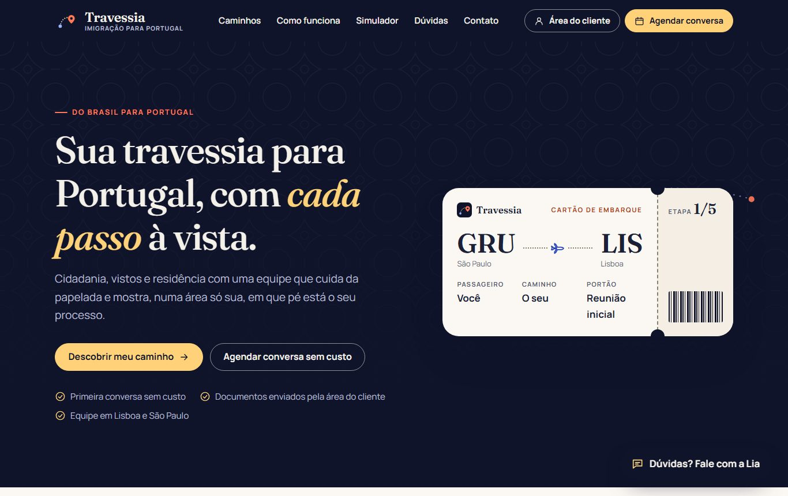

</div>

> **Este é um case de portfólio.** O projeto nasceu em 2023 como o site da ImigraTech e foi
> recriado aqui para mostrar o processo e o resultado. A interface usa a marca fictícia
> **Travessia**. Contatos, endereços, números, consultoras e clientes são de exemplo, e
> nada do que você digita sai do seu navegador. As regras de imigração foram simplificadas
> para ilustrar o fluxo: **não são orientação jurídica**.

---

## Sumário

- [O case](#o-case)
  - [Contexto e problema](#contexto-e-problema)
  - [Objetivo](#objetivo)
  - [Decisões de design](#decisões-de-design)
  - [A marca fictícia](#a-marca-fictícia)
  - [Revisitando o case](#revisitando-o-case)
- [A jornada, tela a tela](#a-jornada-tela-a-tela)
- [O que funciona no protótipo](#o-que-funciona-no-protótipo)
- [Acessibilidade](#acessibilidade)
- [Tecnologias e arquitetura](#tecnologias-e-arquitetura)
- [Como rodar localmente](#como-rodar-localmente)
- [Publicação no GitHub Pages](#publicação-no-github-pages)
- [Segurança e privacidade](#segurança-e-privacidade)
- [Limitações](#limitações)
- [Próximos passos](#próximos-passos)
- [Histórico](#histórico)
- [Autor](#autor)

---

## O case

### Contexto e problema

Mudar de país é uma das decisões mais caras e ansiosas da vida de uma família. Quem procura
uma assessoria para ir do Brasil para Portugal costuma chegar com as mesmas dúvidas:

- *Qual é o meu caminho?* Cidadania, visto de trabalho, de renda, de estudo, de nômade digital… os nomes confundem;
- *Quais documentos eu preciso?* E quais precisam de apostila, tradução, cópia autenticada;
- *Em que pé está o meu processo?* Depois de contratar, a pessoa passa semanas sem notícia e precisa perguntar por WhatsApp;
- *Isso é confiável?* Promessas de "70% mais rápido" não ajudam quem está entregando a vida nas mãos de alguém.

A versão original do site era uma página de apresentação: um topo com chamada, um texto
"sobre nós", contadores, as etapas do trabalho e um espaço reservado onde estava escrito
**"CHAT AQUI"**. Bonita, mas não respondia a nenhuma dessas perguntas.

### Objetivo

Transformar a página de apresentação num serviço que funciona, onde a pessoa:

1. **descobre o seu caminho** em poucos minutos, sem cadastro;
2. **vê a lista de documentos** do caminho, com a explicação de cada um;
3. **agenda a primeira conversa** escolhendo formato, dia e horário;
4. **acompanha o processo** numa área do cliente, com as cinco etapas, o envio de documentos e a conversa com a consultora;
5. **tira dúvidas rápidas** a qualquer hora com um assistente, sem perder o caminho até uma pessoa.

### Decisões de design

| Decisão | Por quê |
| --- | --- |
| **Cartão de embarque** como elemento-assinatura | A metáfora da viagem é imediata e ajuda a explicar a jornada: origem, destino, "portão" (a etapa atual) e o canhoto com a etapa 1/5. Reaparece no agendamento como comprovante. |
| **Simulador de 6 perguntas**, uma por vez | Ninguém sabe o nome do próprio visto. Perguntar sobre a vida da pessoa (motivo, família, renda) e traduzir isso num caminho é mais honesto do que pedir que ela escolha numa lista. |
| Resultado com **"por que este caminho"** | Cada resposta que pesou aparece como motivo. A pessoa entende a recomendação e confia mais nela. |
| **Prazos "de exemplo"** e aviso de que não é parecer jurídico | Imigração muda com frequência. Prometer prazo ou aprovação seria desonesto; o site orienta e encaminha para a reunião. |
| **Agendamento em 3 etapas** com resumo ao lado | Formato e horário primeiro, dados depois. O resumo mostra a escolha o tempo todo, e o fuso (Brasília ou Lisboa) aparece junto do horário. |
| **Área do cliente centrada nos documentos** | É ali que o processo trava. Cada documento diz o que precisa, o status e, quando é recusado, **o motivo e como corrigir**. |
| Envio para a análise final **só com tudo enviado** | Evita idas e vindas: o botão explica quantos documentos ainda faltam. |
| **Modo demonstração** | Simula o que a equipe faria do outro lado (revisar, protocolar, aprovar) para quem avalia o case percorrer a jornada inteira em um minuto. |
| **Assistente Lia** no lugar do "CHAT AQUI" | Responde por palavras-chave, sem IA nem servidor, e sempre oferece o próximo passo: o simulador, os documentos ou uma conversa com a equipe. |
| Números e selos como **carimbos de passaporte** | Dá prova social sem exagero, e conversa com a metáfora da viagem. |

### A marca fictícia

**Travessia** é a palavra para quem cruza o Atlântico, e também para quem atravessa um
processo longo. O símbolo é uma **rota pontilhada** que sai de um ponto azul (o Brasil) e
chega a um **pino coral** (Portugal).

A identidade foge do visual de "sistema" do [Gestão OPME](https://github.com/fernandopinhel/OPME):

- **Fraunces**, uma serifada editorial, para títulos, com o itálico em amarelo-sol para o destaque;
- **Manrope** para o texto;
- **azul-tinta** (`#10142a`) no topo e no rodapé, **papel quente** (`#fbf8f3`) no conteúdo;
- **azulejo português** como textura, desenhado em SVG e aplicado com baixa opacidade;
- **azul-azulejo** (`#2643b8`) para ações, **coral** e **sol** como acentos sobre o escuro.

### Revisitando o case

Em 2026 o projeto foi revisitado. A versão de 2023 era uma página única com Bootstrap 5
alpha, jQuery, AOS, Animate.css, Font Awesome e Google Maps, com o CSS compilado fora do
repositório e cerca de 6 MB de imagens PNG. Agora:

- **Cinco páginas que funcionam**: início, simulador, agendamento, entrada e área do cliente.
- **Um design system próprio** e diferente dos outros cases, sem framework de CSS.
- **Acessibilidade revisada para a WCAG 2.2 AA**, verificada com axe em todas as telas e estados.
- **Textos mais próximos e honestos**, sem promessas de prazo ou de aprovação.
- **Zero dependências de runtime** e nenhuma chave de API no código.
- **Imagens em SVG**: símbolo, azulejo, ícones e ilustrações somam poucos KB.

---

## A jornada, tela a tela

| Início | Caminhos |
| --- | --- |
|  | 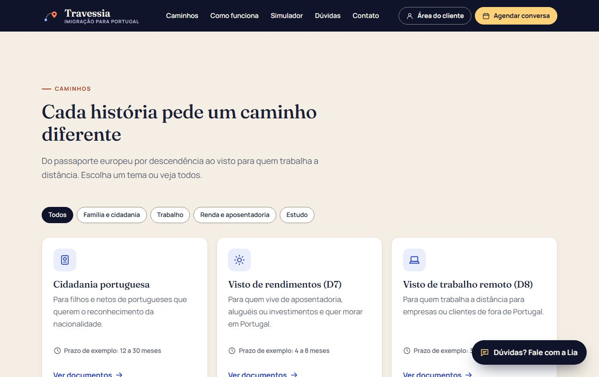 |

| Como funciona | Assistente Lia |
| --- | --- |
| 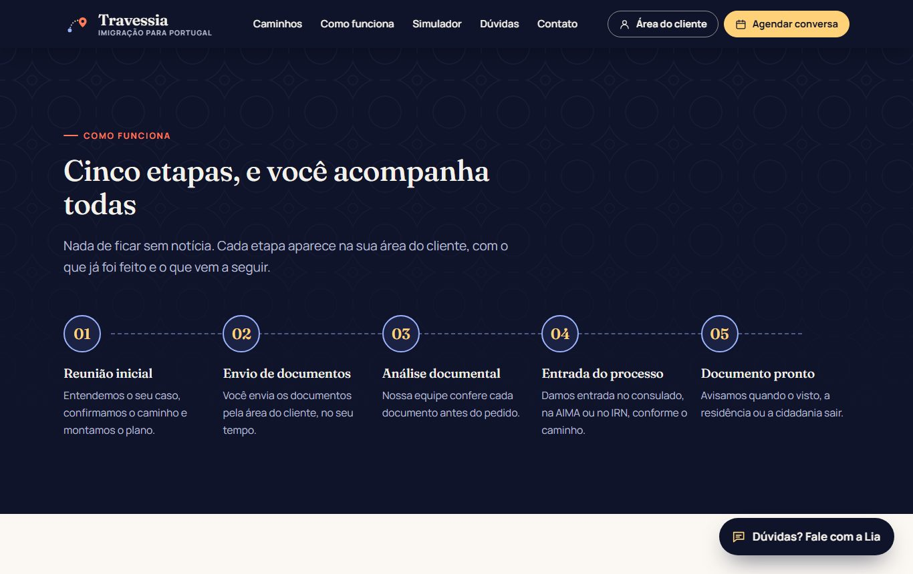 | 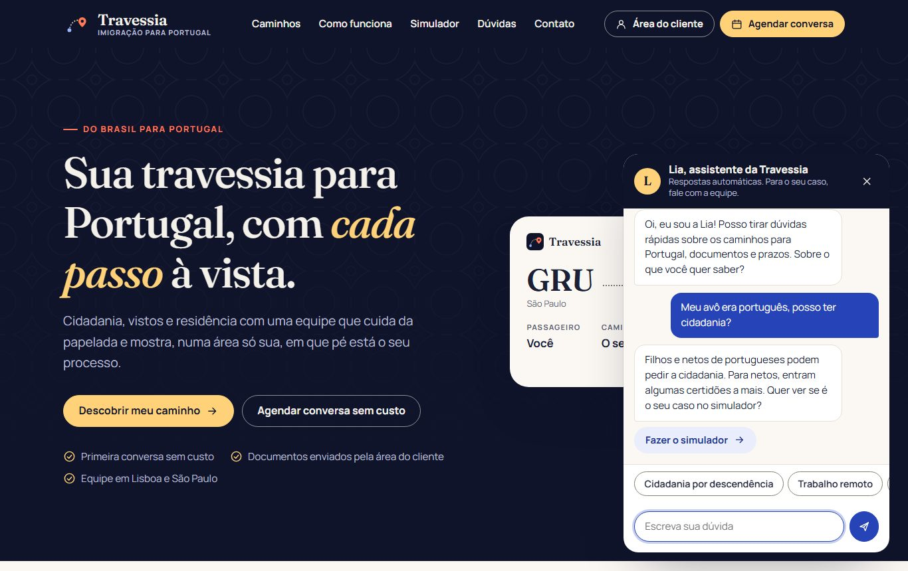 |

| Simulador | Resultado |
| --- | --- |
| 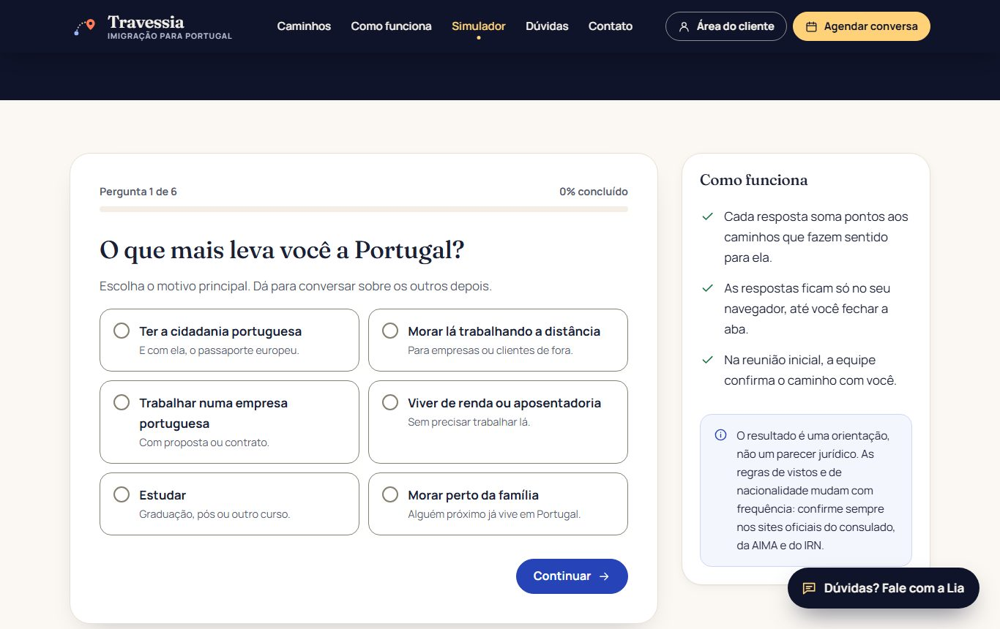 | 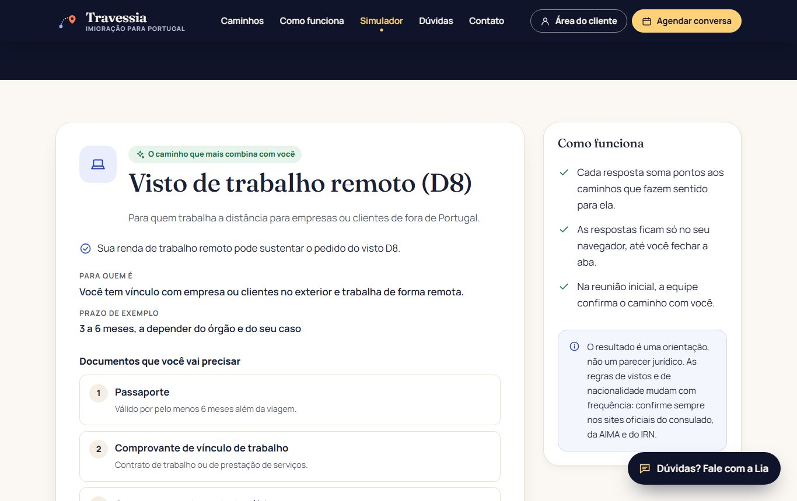 |

| Agendamento | Entrada |
| --- | --- |
| 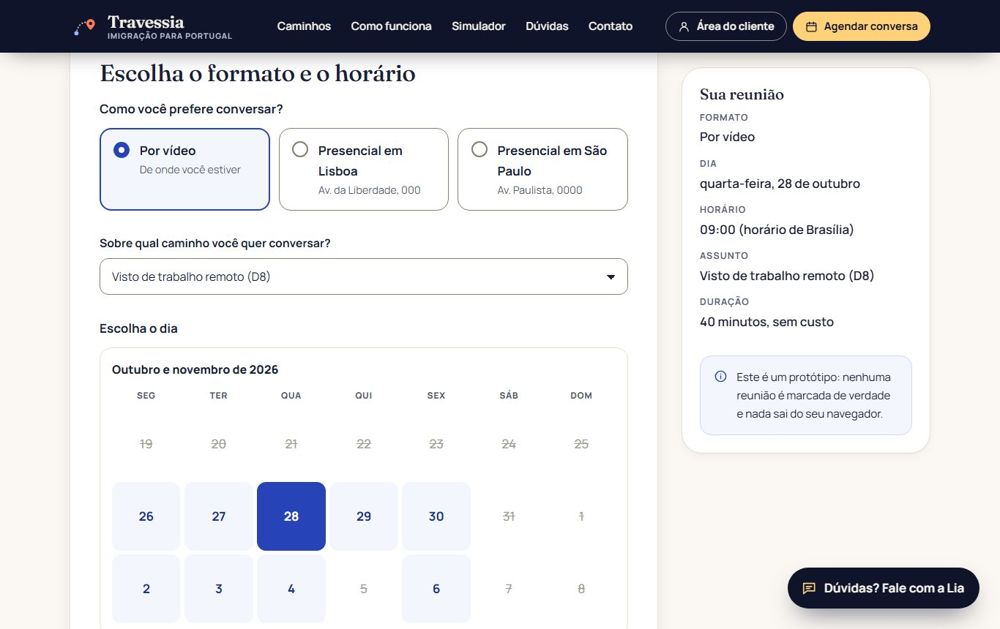 | 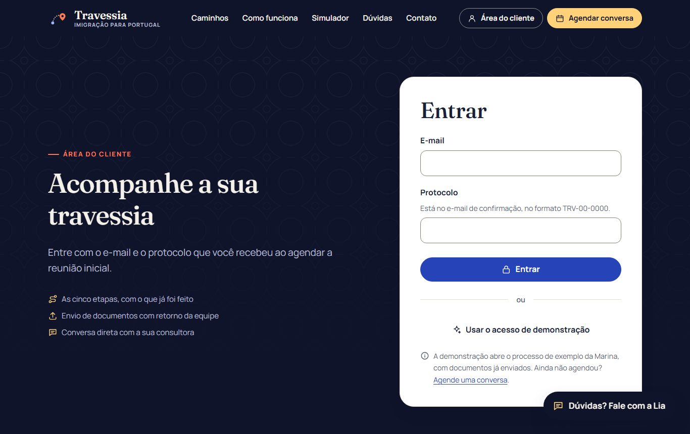 |

| Área do cliente | Documentos |
| --- | --- |
| 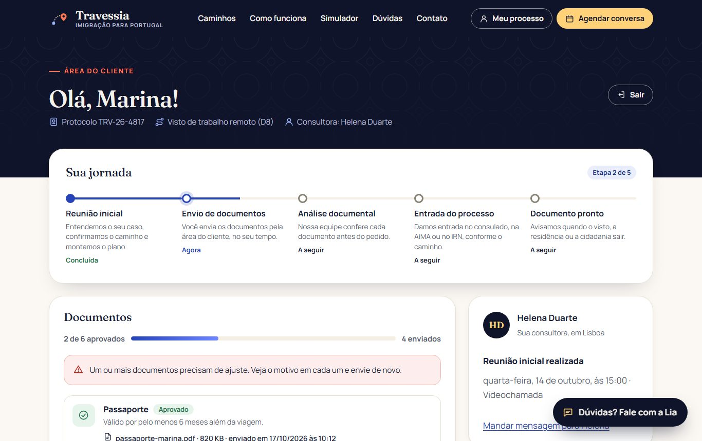 | 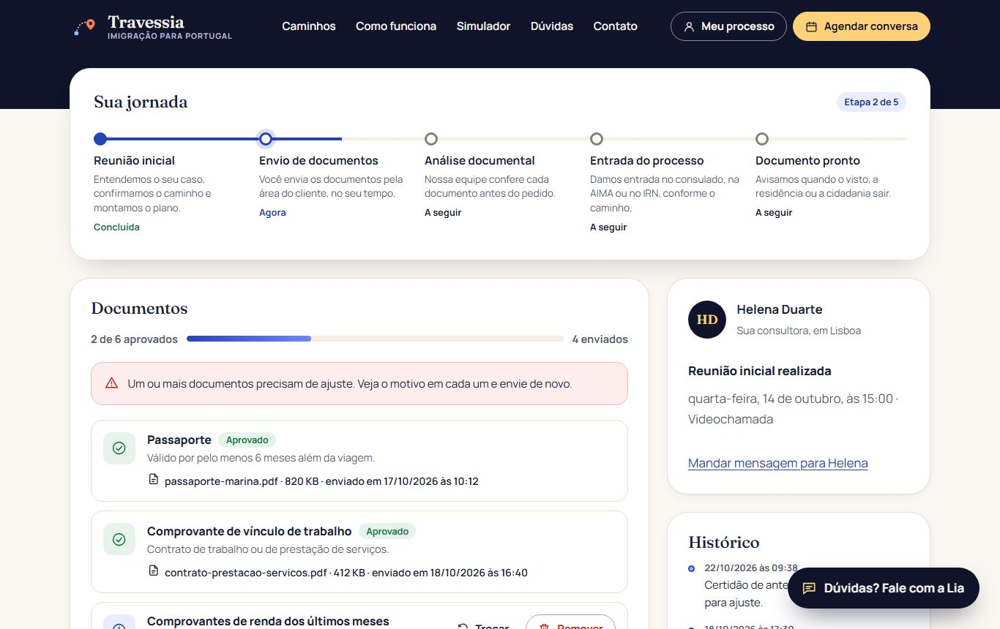 |

| Celular | Documentos no celular |
| --- | --- |
| 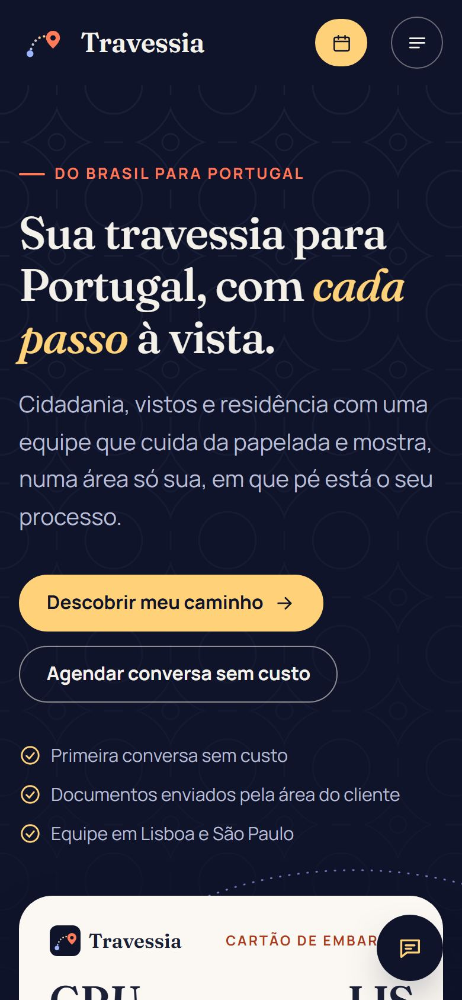 | 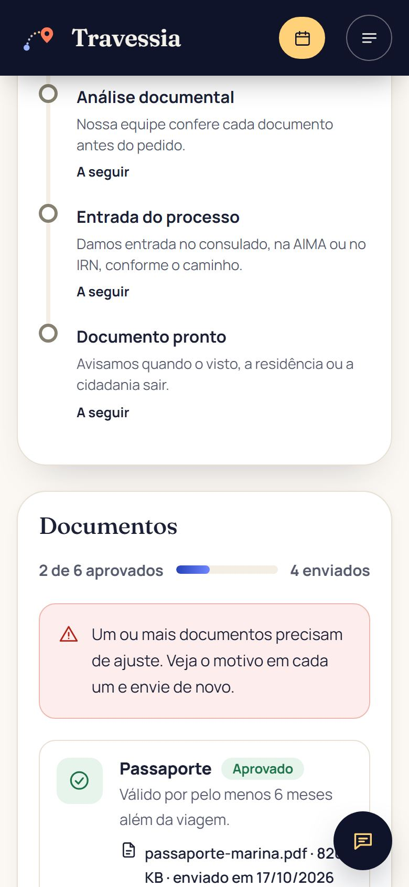 |

| Tela | Arquivo | O que faz |
| --- | --- | --- |
| Início | `index.html` | Topo com o cartão de embarque, números, caminhos com filtro, etapas, prévia da área do cliente, dúvidas com busca e formulário de contato. |
| Simulador | `caminho.html` | Seis perguntas, uma por vez, e o caminho recomendado com motivos, documentos e alternativas. Com `?ver=d8` (ou outro caminho), mostra direto os documentos. |
| Agendamento | `agendar.html` | Formato, caminho, dia e horário; depois os dados; por fim o comprovante, o convite `.ics` e a entrada na área do cliente. |
| Entrada | `entrar.html` | E-mail e protocolo, com máscara e validação, ou o acesso de demonstração. |
| Área do cliente | `portal.html` | Jornada, documentos com envio e status, conversa com a consultora, histórico e modo demonstração. |

---

## O que funciona no protótipo

**Início**
- Filtro dos caminhos por tema, com anúncio de quantos aparecem.
- Busca nas dúvidas, com o termo destacado e as respostas abertas.
- Contato com validação, máscara de telefone e confirmação.
- Contadores animados só para quem não pediu movimento reduzido.

**Simulador**
- Cada resposta soma pontos aos caminhos; o resultado mostra o mais indicado, os motivos e até três alternativas.
- As respostas ficam salvas: quem volta continua de onde parou.
- Lista de documentos pronta para imprimir.

**Agendamento**
- Agenda de exemplo determinística: fins de semana, dias lotados e horários ocupados aparecem riscados.
- O fuso muda com o formato (Lisboa ou Brasília) e a disponibilidade também.
- Bloqueio de e-mail que já tem processo, com o protocolo e o caminho para entrar.
- Convite `.ics` para a agenda e criação do processo na área do cliente.

**Área do cliente**
- Envio de documentos por botão ou arrastando o arquivo; só PDF, JPG e PNG até 10 MB, com mensagens que explicam o que fazer.
- Status por documento (falta enviar, em análise, aprovado, ajustar e reenviar), com o motivo da recusa.
- Trocar ou remover um arquivo em análise, com confirmação.
- Envio para a análise final liberado só quando nada está pendente.
- Conversa com a consultora, com resposta automática.
- Histórico com data e hora de cada passo.
- **Modo demonstração**: simula reunião, revisão, entrada do pedido e decisão, até "Documento pronto".
- **Restaurar dados de exemplo**, no rodapé, volta tudo ao estado original.

---

## Acessibilidade

O protótipo foi revisado para a **WCAG 2.2 nível AA** e verificado com o
[axe-core](https://github.com/dequelabs/axe-core) em todas as telas e estados (erros,
chat aberto, diálogo, fluxo concluído), no desktop e no celular, sem violações.

- **Estrutura**: landmarks, link para pular ao conteúdo, títulos em ordem e trilha de navegação com `aria-current`.
- **Formulários**: rótulo visível, dicas ligadas por `aria-describedby`, erro no campo e num resumo no topo com links que levam ao campo. O erro some enquanto a pessoa corrige.
- **Escolhas em cartão** são rádios nativos dentro de `fieldset` e `legend`, com o foco visível no cartão.
- **Calendário e horários** são botões com `aria-pressed` e nome completo ("segunda-feira, 26 de outubro, sem horários"); a quantidade de horários livres é anunciada.
- **Mudança de etapa** no simulador e no agendamento leva o foco ao novo título e atualiza o título da aba ("Etapa 2 de 3: Seus dados").
- **Chat** com `role="log"`, foco no campo ao abrir, Esc para fechar e foco de volta ao botão.
- **Diálogos** com `<dialog>` nativo: prendem o foco, fecham com Esc e devolvem o foco.
- **Menu no celular** com `aria-expanded`, fecha com Esc e ao escolher um link.
- **Contraste** de pelo menos 4,5:1 em texto e 3:1 em bordas de campos, alvos de 44 px, suporte a movimento reduzido e ao alto contraste do Windows.

---

## Tecnologias e arquitetura

- **HTML, CSS e JavaScript puros**, sem build, sem framework e sem bibliotecas de runtime.
- **Fraunces e Manrope** via Google Fonts.
- **Ícones** num sprite SVG próprio (`img/icons.svg`).

```text
.
├── index.html            Página inicial
├── caminho.html          Simulador de caminho
├── agendar.html          Agendamento da reunião inicial
├── entrar.html           Entrada da área do cliente
├── portal.html           Área do cliente
├── css/site.css          Design system (tokens, componentes, chat, impressão)
├── js/common.js          Armazenamento, validação, máscaras, avisos, cabeçalho e chat
├── js/data.js            Caminhos, simulador, dúvidas, respostas do chat e processo de exemplo
├── js/<página>.js        Comportamento de cada página
├── img/                  Símbolo, azulejo e sprite de ícones (SVG)
└── docs/screenshots/     Capturas usadas neste README
```

**Conteúdo guiado por dados.** Os seis caminhos, com documentos e prazos de exemplo, as
perguntas do simulador e os pontos de cada resposta, as dúvidas e as respostas da Lia estão
em `js/data.js`. Para criar um caminho novo, basta acrescentar um objeto.

**Validação declarativa.** As regras vêm do próprio HTML (`required`,
`data-rules="email telefone"`, `data-mask="protocolo"`), e cada tela só adiciona as regras
de negócio, como o e-mail que já tem processo.

**Dados.** O "banco" é um objeto JSON no `sessionStorage` (chave `trv:db`), criado na
primeira visita com o processo de demonstração. As datas são relativas ao dia de hoje.

---

## Como rodar localmente

O projeto é estático: basta servir a pasta com qualquer servidor HTTP. Prefira um servidor
ao `file://`, porque a CSP e o sprite de ícones se comportam de forma diferente com
arquivos locais.

```bash
git clone https://github.com/fernandopinhel/Travessia.git
cd Travessia

# Opção 1: Python
python3 -m http.server 8080

# Opção 2: Node
npx serve .
```

Depois, acesse <http://localhost:8080>. Para ir direto à área do cliente, abra
**Área do cliente → Usar o acesso de demonstração** (ou entre com
`marina.alves@example.com` e o protocolo `TRV-26-4817`).

Para validar o HTML:

```bash
npx htmlhint@1 "*.html"
```

---

## Publicação no GitHub Pages

O workflow `.github/workflows/pages.yml` publica o site a cada push na `main`. Para ativar:

1. No GitHub, abra **Settings → Pages**.
2. Em **Build and deployment → Source**, escolha **GitHub Actions**.
3. Faça um push na `main` ou rode o workflow em **Actions → Deploy GitHub Pages**.

O endereço será <https://fernandopinhel.github.io/Travessia/>.

O workflow `.github/workflows/ci.yml` valida o HTML com o HTMLHint e bloqueia scripts,
handlers e estilos inline, que a CSP não deixaria rodar.

---

## Segurança e privacidade

- **Nenhum dado sai do navegador.** Não há back-end. Processos, mensagens e respostas ficam no `sessionStorage` e somem ao fechar a aba.
- **Arquivos não são lidos.** Do documento enviado, o protótipo guarda só nome, tamanho e tipo.
- **Content Security Policy** em todas as páginas: `script-src 'self'`, `style-src` sem `'unsafe-inline'`, `object-src 'none'`, `base-uri 'self'` e `form-action 'self'`. Só o Google Fonts é liberado como origem externa.
- **Sem JavaScript nem CSS inline**, e nenhum `innerHTML`: todo texto entra como `textContent`.
- **Sem chaves de API**: a versão original carregava o Google Maps com uma chave no HTML; o mapa saiu.
- **Referrer Policy** `strict-origin-when-cross-origin` e `noindex` para buscadores.
- **Dependabot** monitora as GitHub Actions.

Veja também o [SECURITY.md](SECURITY.md).

---

## Limitações

- É um **protótipo**: não há back-end, autenticação real, envio de e-mail nem agenda de verdade.
- O assistente responde por palavras-chave; perguntas fora do roteiro vão para "agende uma conversa".
- As regras, documentos e prazos de cada caminho são **simplificados e de exemplo**. Para decisões reais, consulte o consulado, a AIMA, o IRN ou um profissional habilitado.
- Os dados vivem só na aba do navegador. Outra aba ou outro navegador começa do zero.
- A marca Travessia e todos os dados são fictícios. O repositório **não tem licença de código aberto**.

---

## Próximos passos

- [ ] Testes de fluxo (Playwright) e auditoria de acessibilidade (axe) no CI.
- [ ] Versão em inglês e em português europeu.
- [ ] Planos para a família inteira, com documentos por pessoa.
- [ ] Lembretes de validade (passaporte, antecedentes criminais, seguro).
- [ ] Painel da equipe, com a fila de documentos para revisar.

---

## Histórico

### 2026-10: Case revisitado

- Marca fictícia Travessia, com símbolo de rota entre Brasil e Portugal, azulejo e cartão de embarque.
- Reescrita completa em HTML, CSS e JavaScript puros, com cinco páginas funcionais.
- Simulador de caminho, agendamento, área do cliente com envio de documentos e assistente Lia.
- Acessibilidade revisada para a WCAG 2.2 AA, verificada com axe.
- Saíram Bootstrap, jQuery, AOS, Animate.css, Font Awesome, Google Maps e as imagens PNG.
- CI com HTMLHint e bloqueio de código inline, publicação no GitHub Pages por workflow, Dependabot e `SECURITY.md`.

### 2023-05: Versão original

Página de apresentação da ImigraTech com Bootstrap, jQuery e animações.

---

## Autor

**Fernando Pinhel**, Fullstack Designer (UX/UI, Design Systems e Front-end)
[fernandopinhel.com.br](https://fernandopinhel.com.br) · [GitHub](https://github.com/fernandopinhel)
